# 📘 สรุป Data Science บทที่ 8–14

> [!abstract] ภาพรวมทั้ง 7 บทในประโยคเดียว
> **ทำนายตัวเลข (บท 8) → ทำนายหมวดหมู่ (บท 9) → รวมหลายโมเดลให้เก่งขึ้น (บท 10) → หากลุ่มเมื่อไม่มีคำตอบ (บท 11) → วัดผลให้เชื่อถือได้ (บท 12) → เล่าเรื่องและส่งมอบงาน (บท 13) → ทำทั้งหมดครบวงจร (บท 14)**

> [!tip] วิธีอ่านไฟล์นี้
> - เน้น **"ไอเดีย"** ไม่ลงรายละเอียดโค้ด
> - กล่องสี ๆ = จุดสำคัญ / ข้อควรระวัง / ตัวอย่าง
> - คลิกสารบัญด้านขวา (Outline) เพื่อกระโดดไปบทที่ต้องการ

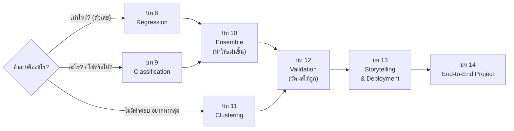

---

## 📑 สารบัญ
- [[#บทที่ 8 Regression — การทำนายค่าต่อเนื่อง]]
- [[#บทที่ 9 Classification — การจำแนกประเภท]]
- [[#บทที่ 10 Ensemble Methods — รวมพลังหลายโมเดล]]
- [[#บทที่ 11 Clustering — การจัดกลุ่มข้อมูล]]
- [[#บทที่ 12 Model Validation & Selection]]
- [[#บทที่ 13 Data Storytelling และการเขียนรายงาน]]
- [[#บทที่ 14 โครงงาน Data Science แบบ End-to-End]]
- [[#🧠 Cheat Sheet รวมทุกบท]]

---

# บทที่ 8 Regression — การทำนายค่าต่อเนื่อง

## 8.1 Regression คืออะไร

> [!info] นิยามแบบง่าย
> **Regression** = Supervised Learning ที่ใช้ **ทำนายตัวเลขต่อเนื่อง** เช่น ราคา น้ำหนัก อุณหภูมิ ยอดขาย
> 👉 ถ้าคำถามขึ้นต้นด้วย **"เท่าไหร่? / กี่?"** ให้นึกถึง Regression

| | **Regression** | **Classification** |
|---|---|---|
| Target | ตัวเลขต่อเนื่อง (Continuous) | หมวดหมู่ (Categorical) |
| ผลลัพธ์ | ตัวเลขจริง เช่น 5,350 บาท | คลาส หรือ ความน่าจะเป็น |
| ตัวอย่างคำถาม | บ้านหลังนี้ราคาเท่าไหร่? | ผู้ป่วยเป็นเบาหวานหรือไม่? |
| Metrics | MAE, MSE, RMSE, R² | Accuracy, Precision, Recall, F1 |

**สมการหัวใจ:**

$$Y = f(X) + \epsilon$$

- $f$ = ความสัมพันธ์ "จริง" ที่เราไม่รู้ → ML มีหน้าที่ **ประมาณ** ให้ได้ $\hat f$
- $\epsilon$ = **Irreducible Error** — ปัจจัยที่ไม่ได้เก็บมา (เช่น หอพักไกลแต่มีสระว่ายน้ำ) ลดไม่ได้ไม่ว่าโมเดลจะเก่งแค่ไหน

> [!example] เราประมาณ f ไปทำไม? 2 เหตุผล
> 1. **Prediction (ทำนาย)** — มีข้อมูลใหม่ อยากรู้ค่า Y เช่น ประเมินราคาบ้านหลังใหม่
> 2. **Inference (อนุมาน/อธิบาย)** — อยากรู้ว่า X กระทบ Y อย่างไร เช่น "ห่าง มข. เพิ่ม 1 กม. ค่าเช่าลดกี่บาท"

ตัวอย่างการใช้ในไทย: ทำนายค่าเช่าหอรอบ มข., เงินเดือนบัณฑิตจบใหม่, ค่าฝุ่น PM2.5 อีสาน, ยอดซื้อช่วง 11.11

---

## 8.2 Simple Linear Regression (ตัวแปรต้น 1 ตัว)

$$Y = \beta_0 + \beta_1 X + \epsilon$$

| สัญลักษณ์ | ชื่อ | ความหมายแบบภาษาคน |
|---|---|---|
| $\beta_0$ | Intercept | ค่า Y ตอนที่ X = 0 ("ค่าตั้งต้น") |
| $\beta_1$ | Slope | X เพิ่ม 1 หน่วย → Y เปลี่ยนเฉลี่ยกี่หน่วย |
| $\epsilon$ | Error | ทุกอย่างที่ X อธิบายไม่ได้ |

> [!example] ตีความจริง
> ยอดขาย = 50 + 3.5 × (งบโฆษณา) (หน่วยหมื่นบาท)
> - ไม่ยิงแอดเลยก็ขายได้ 50 หมื่น (ลูกค้าประจำ)
> - เพิ่มงบแอด 1 หมื่น → ขายเพิ่มเฉลี่ย 3.5 หมื่น

### OLS — หาเส้นที่ "ดีที่สุด" ยังไง?

![[ds-08-ols.png]]

- **Residual** $e_i = y_i - \hat y_i$ = ระยะห่างแนวตั้งจากจุดจริงถึงเส้น (เส้นประในรูป)
- **OLS (Ordinary Least Squares)** = เลือกเส้นที่ทำให้ $\sum e_i^2$ **น้อยที่สุด**

> [!question] ทำไมต้อง "ยกกำลังสอง"?
> 1. ไม่ให้ค่าบวก–ลบหักล้างกันจนดูเหมือน error = 0
> 2. **ลงโทษจุดที่พลาดมาก ๆ หนักขึ้น** (พลาด 10 → นับ 100)

---

## 8.3 Multiple Linear Regression (ตัวแปรต้นหลายตัว)

$$y = \beta_0 + \beta_1x_1 + \beta_2x_2 + \dots + \beta_nx_n + \epsilon$$

> [!important] กฎทองของการตีความ
> $\beta_i$ = ผลของ $x_i$ **"เมื่อตัวแปรอื่นคงที่" (holding others constant)**
> เช่น ราคาคอนโด = 500,000 + 55,000(พื้นที่) − 15,000(ระยะทาง) → "ถ้าระยะทางเท่ากัน ห้องใหญ่ขึ้น 1 ตร.ม. แพงขึ้น 55,000"

### Raw vs Standardized Coefficients

| | Raw | Standardized |
|---|---|---|
| หน่วย | มีหน่วยตามตัวแปร | ไม่มีหน่วย (ทำ Z-score ก่อน) |
| ใช้ทำอะไร | ทำนายค่าจริง / อธิบายในหน่วยจริง | **เปรียบเทียบว่าตัวแปรไหนสำคัญกว่า** |

> [!warning] กับดัก: เลขใหญ่ ≠ สำคัญกว่า
> 55,000 (ต่อ ตร.ม.) กับ −15,000 (ต่อ กม.) เทียบกันตรง ๆ ไม่ได้ เพราะหน่วยต่างกัน → ต้องใช้ Standardized

### Multicollinearity — ตัวแปรต้น "ซ้ำซ้อนกันเอง"

เช่น ใส่ทั้ง **น้ำหนัก** และ **BMI** (BMI คำนวณจากน้ำหนักอยู่แล้ว)

ผลเสีย:
- β ไม่เสถียร ข้อมูลเปลี่ยนนิดเดียวค่ากระโดด หรือกลับเครื่องหมาย
- ตีความผิด ("เพิ่มน้ำหนักแต่ BMI คงที่" เป็นไปไม่ได้)
- Standard error พอง ทำให้ตัวแปรที่สำคัญดูไม่สำคัญ

**ตรวจด้วย VIF:** $VIF_i = \dfrac{1}{1-R_i^2}$

| VIF | แปลว่า |
|---|---|
| = 1 | ไม่สัมพันธ์กับตัวอื่นเลย |
| 1–5 | พอรับได้ |
| ≥ 5 | ⚠️ เริ่มมีปัญหา |
| ≥ 10 | 🚨 รุนแรง → ตัดตัวแปรทิ้ง / ใช้ PCA / ใช้ Ridge |

---

## 8.4 Evaluation Metrics สำหรับ Regression

| Metric | สูตร (แนวคิด) | หน่วย | ไวต่อ Outlier | ใช้เมื่อ |
|---|---|---|---|---|
| **MAE** | เฉลี่ยของ \|error\| | เดียวกับ Y | ต่ำ (ทนทาน) | อธิบายผู้บริหารง่าย ๆ "เฉลี่ยพลาด 1.2 วัน" |
| **MSE** | เฉลี่ยของ error² | หน่วย² (ตีความยาก) | สูงมาก | ต้องลงโทษพลาดใหญ่ / ใช้ optimize โมเดล |
| **RMSE** | $\sqrt{MSE}$ | เดียวกับ Y | สูง | อยากได้แบบ MSE แต่อ่านง่าย |
| **R²** | $1 - \frac{SS_{res}}{SS_{tot}}$ | ไม่มีหน่วย (0–1) | ปานกลาง | ดูว่าอธิบายความแปรปรวนได้กี่ % |
| **Adjusted R²** | R² ที่หักคะแนนตามจำนวนตัวแปร | ไม่มีหน่วย | ปานกลาง | **เทียบโมเดลที่จำนวนตัวแปรต่างกัน** |

> [!tip] จำง่าย ๆ
> - **RMSE ≥ MAE เสมอ** — ยิ่งห่างกันมาก แปลว่ามีบางจุดพลาดหนัก
> - **R² = 0.65** → "65% ของความแตกต่างของ Y อธิบายได้ด้วยโมเดลนี้"
> - **R² = 0** → ไม่ดีกว่าการเดาด้วยค่าเฉลี่ย, **R² ติดลบได้** ถ้าแย่กว่าค่าเฉลี่ย

> [!warning] R² หลอกได้!
> R² **เพิ่มขึ้นเสมอ** เมื่อใส่ตัวแปรเพิ่ม แม้ตัวแปรนั้นไร้สาระ (เช่น "สีรถของผู้กู้")
> → ต้องดู **Adjusted R²** ซึ่งจะ **ลดลง** ถ้าตัวแปรใหม่ไม่ช่วยจริง

> [!example] MSE vs MAE ในชีวิตจริง
> ทำนายเตียง ICU: ขาด 20 เตียงในวันเดียว อันตรายกว่า ขาด 4 เตียง × 5 วัน → ใช้ **MSE/RMSE** เพื่อบังคับให้โมเดลกลัวการพลาดก้อนใหญ่

---

## 8.5 Regression Diagnostics — ตรวจสุขภาพโมเดล

Linear Regression มีสมมติฐาน 4 ข้อ จำว่า **LINE**

| ตัวอักษร | สมมติฐาน | ถ้าผิดจะเป็นยังไง | ตัวอย่าง |
|---|---|---|---|
| **L** | Linearity — ความสัมพันธ์เป็นเส้นตรง | Underfit | ยอดขายอิ่มตัวเมื่อเพิ่มงบแอด |
| **I** | Independence — error แต่ละจุดเป็นอิสระ | p-value เพี้ยน | ผู้ป่วยไข้เลือดออกรายวัน (time series) |
| **N** | Normality — error แจกแจงปกติ | ช่วงความเชื่อมั่นไม่น่าเชื่อ | มี outlier เยอะ |
| **E** | Equal variance (Homoscedasticity) | ทำนายค่าสูงแม่นน้อยลง | คอนโด Penthouse ราคาแกว่งมาก |

![[ds-08-residuals.png]]

**เครื่องมือ:**
- **Residuals vs Fitted plot** → ตรวจ L และ E (ควรเป็นก้อนเมฆสุ่มรอบ 0)
- **Q-Q plot** → ตรวจ N (จุดควรเกาะเส้นทแยง 45°)

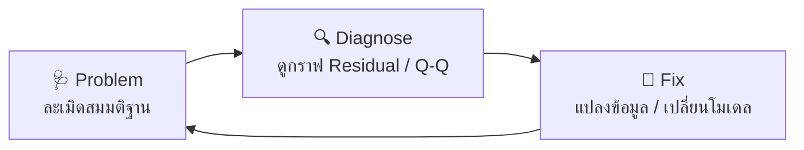

| ปัญหา | อาการในกราฟ | วิธีแก้ |
|---|---|---|
| Non-linearity | รูปตัว U / โค้ง | เพิ่ม Polynomial ($x^2$), แปลง $\log x$ |
| Heteroscedasticity | รูปกรวย | แปลง $\log y$, ใช้ WLS |
| Non-normality | Q-Q หางเบี่ยง | จัดการ outlier, Box-Cox |
| Autocorrelation | residual เป็นคลื่นตามเวลา | เพิ่ม Lag feature, ใช้ ARIMA |

---

## 8.6 การปรับปรุงโมเดล

### (1) Feature Selection — คัดตัวแปร
มีตัวแปรเยอะเกินไป → **Curse of Dimensionality**, ช้า, overfit

| วิธี | หลักการ | ข้อดี / ข้อเสีย |
|---|---|---|
| **Filter** | ใช้สถิติวัดแต่ละตัว (Correlation, F-test) | เร็ว ไม่ผูกกับโมเดล |
| **Wrapper** | ลองหลายชุดตัวแปรแล้วดูผล (เช่น RFE) | แม่นแต่กินทรัพยากร |
| **Embedded** | โมเดลเลือกเองระหว่างเทรน (Lasso, Tree) | สมดุลดี |

### (2) Data Transformation — แปลงข้อมูล
- **Log Transform** → แก้ข้อมูลเบ้ขวา (คอนโดส่วนใหญ่ 2–5 ล้าน แต่มีบางห้อง 100 ล้าน) บีบค่าใหญ่ให้เล็กลง ลดอิทธิพล outlier (ใช้ `log1p` กัน log 0)
- **Polynomial Features** → เพิ่ม $x^2, x^3$ เพื่อจับความโค้ง (เช่น ใช้ไฟมากทั้งตอนหนาวและร้อน = รูปตัว U)

> [!note] Polynomial ยังนับเป็น "Linear" Regression
> เพราะ "เชิงเส้นในพารามิเตอร์ β" ถึงแม้ X จะยกกำลังก็ตาม

### (3) Regularization — ลงโทษโมเดลที่ซับซ้อนเกิน

$$Loss = MSE + \underbrace{\lambda \times \text{Penalty}}_{\text{ค่าปรับ}}$$

![[ds-08-ridge-lasso.png]]

| | **Ridge (L2)** | **Lasso (L1)** |
|---|---|---|
| Penalty | $\lambda\sum\beta^2$ | $\lambda\sum\|\beta\|$ |
| ผลต่อ β | หดเข้าใกล้ 0 แต่ **ไม่ถึง 0** | หดจน **= 0 ได้** |
| Feature Selection | ❌ | ✅ อัตโนมัติ |
| เด่นเรื่อง | จัดการ Multicollinearity | สร้างโมเดลเรียบง่าย (Sparse) |
| ใช้เมื่อ | เชื่อว่าทุกตัวแปรมีส่วน | เชื่อว่ามีแค่ไม่กี่ตัวที่สำคัญ, หรือ p > n |

> [!tip] λ (alpha) = ปุ่มปรับความเข้ม
> λ = 0 → Linear Regression ปกติ · λ สูงมาก → β ถูกบีบจนแบนราบ (underfit)

---

## 8.7 Polynomial Regression — จับความสัมพันธ์แบบโค้ง

$$y = \beta_0 + \beta_1x + \beta_2x^2 + \dots + \beta_dx^d$$

![[ds-08-fit.png]]

- Degree ต่ำไป → **Underfit** · Degree สูงไป → **Overfit** (เส้นคดตาม noise)
- เลือก degree ด้วย **Cross-Validation** (บท 12)

> [!success] สูตรมาตรฐานในงานจริง
> **Pipeline = PolynomialFeatures → StandardScaler → Ridge**
> (ต้อง Scale ก่อน Regularize เสมอ ไม่งั้นตัวแปรสเกลใหญ่จะโดนลงโทษไม่เท่ากัน)

> [!summary] สรุปบทที่ 8
> - Regression = ทำนาย "เท่าไหร่" · OLS หาเส้นที่ผลรวม residual² น้อยสุด
> - Multiple LR ตีความแบบ "ตัวอื่นคงที่" · ระวัง Multicollinearity (เช็ก VIF)
> - Metrics: MAE (อ่านง่าย), RMSE (ลงโทษพลาดใหญ่), R²/Adj. R² (อธิบายได้กี่ %)
> - ตรวจ LINE ด้วย Residual plot → Problem → Diagnose → Fix
> - ปรับปรุง: Feature Selection, Log/Polynomial, Ridge/Lasso

---

# บทที่ 9 Classification — การจำแนกประเภท

## 9.1 Classification คืออะไร

> [!info] นิยาม
> ทำนาย **หมวดหมู่ (Class)** ของข้อมูล — Target เป็นค่าไม่ต่อเนื่อง
> $Y = f(X)$ โดย $Y \in \{C_1, C_2, \dots, C_k\}$

**3 ประเภท:**

| ประเภท | ลักษณะ | ตัวอย่าง |
|---|---|---|
| **Binary** | 2 คลาส | Spam / ไม่ Spam, ป่วย / ไม่ป่วย |
| **Multiclass** | >2 คลาส แต่ข้อมูลอยู่ได้คลาสเดียว | เกรด A–F, พันธุ์ข้าว หอมมะลิ/กข6/ไรซ์เบอร์รี่ |
| **Multilabel** | ข้อมูลหนึ่งมีได้หลาย label | หนังเป็นทั้ง Action + Sci-Fi + Comedy |

ตัวอย่างไทย: กรองอีเมลหลอกลวงของ มข., ทำนายลูกค้าย้ายค่ายมือถือ (Churn), คัดกรองไข้เลือดออก, จำแนกพันธุ์ข้าว

---

## 9.2 Decision Tree — ต้นไม้ตัดสินใจ

> [!info] ไอเดีย
> ถามคำถาม **ใช่/ไม่ใช่** ไปเรื่อย ๆ แบ่งข้อมูลจนแต่ละกลุ่ม "บริสุทธิ์" (เป็นคลาสเดียวกัน)

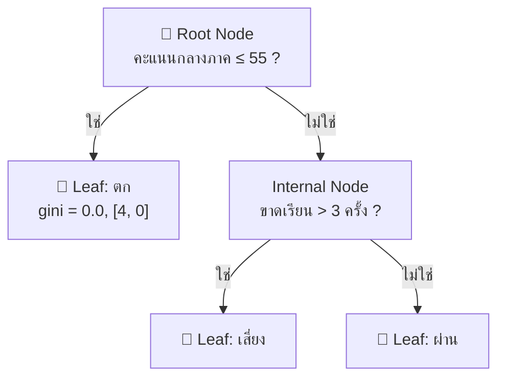

- **Root node** = จุดเริ่ม · **Internal node** = เงื่อนไข · **Leaf** = คำตอบ

### เลือกคำถาม (split) ยังไง? → วัด "ความไม่บริสุทธิ์"

| มาตรวัด | สูตร | ค่า |
|---|---|---|
| **Gini Impurity** | $1 - \sum p_i^2$ | 0 = บริสุทธิ์, 0.5 = ปนกัน 50:50 (2 คลาส) |
| **Entropy** | $-\sum p_i \log_2 p_i$ | 0 = บริสุทธิ์, 1 = ปนสุด (2 คลาส) |

> [!example] คำนวณ Gini
> โหนดมีอนุมัติ 6 ไม่อนุมัติ 4 → $1 - (0.6^2 + 0.4^2) = 0.48$
> อัลกอริทึมเลือก split ที่ **Information Gain** สูงสุด = ลดความไม่บริสุทธิ์ได้มากสุด

### Hyperparameters สำหรับกัน Overfit (Pruning)

| พารามิเตอร์ | ความหมาย |
|---|---|
| `max_depth` | ความลึกสูงสุด (น้อยไป underfit, มากไป overfit) |
| `min_samples_split` | ต้องมีข้อมูลอย่างน้อยกี่ตัวถึงจะแตกกิ่งได้ |
| `min_samples_leaf` | ใบต้องมีข้อมูลอย่างน้อยกี่ตัว (กัน noise) |

| ✅ ข้อดี | ❌ ข้อเสีย |
|---|---|
| **White-box** อธิบายได้ เหมาะแพทย์/การเงิน | ไม่เสถียร (ข้อมูลเปลี่ยนนิดเดียว ต้นไม้เปลี่ยนทั้งต้น) |
| **ไม่ต้อง Scale** ข้อมูล | Overfit ง่ายถ้าไม่ prune |
| จับความสัมพันธ์ไม่เป็นเส้นตรงได้ | เส้นแบ่งเป็นมุมฉากตามแกน (เส้นทแยงทำได้ไม่ดี) |

---

## 9.3 k-Nearest Neighbors (k-NN)

> [!info] ไอเดีย "บอกฉันว่าเพื่อนเธอเป็นใคร แล้วฉันจะบอกว่าเธอเป็นใคร"
> 1. วัดระยะจากจุดใหม่ไปทุกจุดในข้อมูลฝึก
> 2. เลือก **k จุดที่ใกล้ที่สุด**
> 3. **โหวตเสียงข้างมาก** → ได้คลาส

- เป็น **Lazy / Instance-based Learning** — ไม่สร้างสมการตอนเทรน แค่ "จำ" ข้อมูลไว้
- ระยะทาง: **Euclidean** (เส้นตรง) หรือ **Manhattan** (เดินตามบล็อกถนน)

> [!danger] ต้อง Scale ข้อมูลก่อนเสมอ!
> อายุ (20–60) vs รายได้ (15,000–200,000) → ระยะทางถูก "รายได้" ครอบงำหมด
> ลูกค้าอายุต่างกัน 25 ปี แต่รายได้เท่ากัน ดันดู "ใกล้" กว่าคนอายุต่าง 1 ปีแต่รายได้ต่าง 5,000
> → ใช้ **StandardScaler** ($z = \frac{x-\mu}{\sigma}$)

### เลือก k ยังไง

![[ds-09-knn-k.png]]

| k | ผล |
|---|---|
| เล็ก (k=1) | ขอบเขตขรุขระ ไวต่อ noise → **Overfit** (low bias, high variance) |
| ใหญ่มาก | ขอบเขตเรียบเกิน กลุ่มเล็กหาย → **Underfit** |

- ใช้ **Elbow Method**: plot error vs k แล้วเลือกจุด "ข้อศอก"
- 2 คลาส → ใช้ **k เลขคี่** กันโหวตเสมอ
- **Distance Weighting** ($w = 1/d$) → เพื่อนใกล้มีเสียงดังกว่าเพื่อนไกล

| ✅ ข้อดี | ❌ ข้อเสีย |
|---|---|
| เข้าใจง่าย ไม่ต้องเทรน | ทำนายช้า (ต้องวัดระยะกับทุกจุด) |
| รองรับหลายคลาสโดยธรรมชาติ | กิน RAM (เก็บข้อมูลทั้งหมด) |
| เพิ่มข้อมูลใหม่ใช้ได้ทันที | **Curse of Dimensionality** — มิติเยอะทุกจุดดูไกลเท่ากันหมด |

---

## 9.4 Classification Metrics

### Confusion Matrix — รากฐานของทุก Metric

![[ds-09-confusion.png]]

| Metric | สูตร | ตอบคำถาม |
|---|---|---|
| **Accuracy** | $\frac{TP+TN}{ทั้งหมด}$ | ทายถูกกี่ % โดยรวม |
| **Precision** | $\frac{TP}{TP+FP}$ | ที่บอกว่า "ใช่" — ใช่จริงกี่ %? |
| **Recall (Sensitivity)** | $\frac{TP}{TP+FN}$ | ของที่ "ใช่จริง" — จับได้กี่ %? |
| **F1-Score** | $2 \cdot \frac{P \cdot R}{P+R}$ | สมดุลระหว่าง Precision กับ Recall |

> [!question] F1 ทำไมใช้ Harmonic Mean?
> เพื่อ **ลงโทษ** กรณีที่ตัวใดตัวหนึ่งต่ำมาก — Precision 1.0 แต่ Recall 0.0 ค่าเฉลี่ยปกติได้ 0.5 แต่ F1 ได้ 0

### เลือก Metric ตามบริบท (สำคัญมาก!)

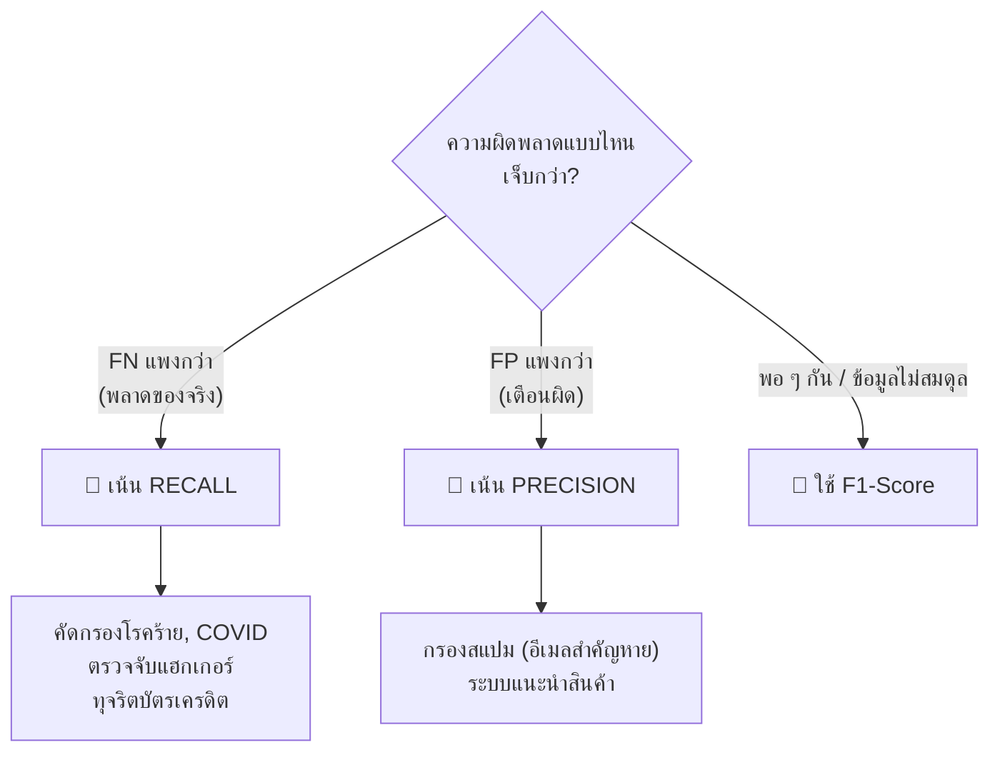

### ⚠️ Imbalanced Data — กับดักของ Accuracy

> [!danger] Accuracy 99.9% แต่ไร้ประโยชน์
> ธุรกรรมปกติ 999,000 / ทุจริต 1,000 → โมเดลขี้เกียจทายว่า "ปกติ" ทุกอัน
> → Accuracy = **99.9%** แต่ Recall ของทุจริต = **0%** (จับไม่ได้สักรายการ)
> **บทเรียน:** ข้อมูลไม่สมดุล → ห้ามดูแค่ Accuracy ต้องดู Confusion Matrix, Precision, Recall, F1

### Multiclass & Multilabel
- **One-vs-Rest**: มองทีละคลาสเป็น Positive ที่เหลือเป็น Negative
- วิธีเฉลี่ย:
  - **Macro** = ทุกคลาสน้ำหนักเท่ากัน → ดีเมื่อ **คลาสเล็กสำคัญ** (เช่นกลุ่มเสี่ยงตก)
  - **Micro** = รวม TP/FP/FN ทุกคลาสก่อน → ภาพรวม
  - **Weighted** = ถ่วงตามจำนวนข้อมูลแต่ละคลาส
- Multilabel เพิ่ม: **Hamming Loss** (สัดส่วน label ที่ผิด ยิ่งต่ำยิ่งดี), **Jaccard** (ความคล้ายชุด label ยิ่งสูงยิ่งดี), **Subset Accuracy** (ต้องถูกทุก label — เข้มสุด)

---

## 9.5 เปรียบเทียบและเลือกโมเดล

> [!quote] No Free Lunch Theorem
> ไม่มีอัลกอริทึมไหนดีที่สุดสำหรับทุกปัญหา

| คุณสมบัติ | k-NN | Decision Tree |
|---|---|---|
| ประเภท | Lazy Learning | Eager Learning |
| เวลาเทรน | เร็วมาก (แค่จำ) | พอสมควร |
| เวลาทำนาย | **ช้า** | **เร็วมาก** |
| ต้อง Scale | ✅ จำเป็น | ❌ ไม่ต้อง |
| อธิบายผล | ต่ำ (Black-box) | สูงมาก (White-box) |

- **เลือก Tree** เมื่อต้องอธิบายเหตุผล เช่น ธนาคารต้องบอกลูกค้าว่าทำไมไม่อนุมัติสินเชื่อ (ธปท. กำหนด)
- **เลือก k-NN** เมื่องานคือ "หาสิ่งที่คล้ายกัน" เช่น หาผู้ป่วยที่อาการใกล้เคียงเพื่อดูแนวทางรักษา

**Overfitting & max_depth:** ต้นไม้ลึกขึ้น → Train accuracy → 100% แต่ Test accuracy คงที่หรือตก = Overfit

**Feature Selection ในตัว:** Decision Tree ไม่เลือก feature ที่ไม่ช่วยลด impurity → เช่น Iris ใช้แค่ "กลีบดอก (Petal)" 2 ตัวก็แม่นเท่าใช้ทั้ง 4 ตัว

---

## 9.6 Logistic Regression — Baseline ที่ควรลองก่อนเสมอ

> [!info] ไอเดีย
> เอาสมการ Linear Regression ($z$) มาผ่าน **Sigmoid** ให้กลายเป็นความน่าจะเป็น 0–1
> $$P(Y=1|X) = \sigma(z) = \frac{1}{1+e^{-z}}$$

![[ds-09-sigmoid.png]]

> [!question] ทำไมใช้ Linear Regression ตรง ๆ ไม่ได้?
> เพราะมันให้ค่าติดลบหรือเกิน 1 ได้ — ความน่าจะเป็น −0.3 หรือ 1.4 ไม่มีความหมาย

**ตีความ Coefficient:**
- β > 0 → เพิ่มโอกาสเป็นคลาส 1 · β < 0 → ลดโอกาส · |β| ใหญ่ → อิทธิพลมาก

> [!tip] Threshold ปรับได้!
> ค่า default คือ 0.5 แต่ถ้า **FN อันตราย** (เช่นคัดกรอง COVID) ควรลดเหลือ ~0.3 → Recall สูงขึ้น (แลกกับ Precision ที่ลดลง)

| | Logistic Reg. | Decision Tree | k-NN |
|---|---|---|---|
| Decision boundary | เส้นตรง | ขั้นบันได | โค้งตามข้อมูล |
| อธิบายผล | สูง (β) | สูง (กฎ) | ต่ำ |
| Non-linearity | ไม่ได้ (ต้อง engineer) | ได้ | ได้ |
| เหมาะกับ | **Baseline** | ต้องการกฎอธิบายได้ | กลุ่มข้อมูลชัด |

> [!summary] สรุปบทที่ 9
> - Classification = ทำนาย "อะไร / ใช่หรือไม่"
> - Decision Tree: กฎ If-Then, แบ่งด้วย Gini/Entropy, ระวัง overfit
> - k-NN: ดูเพื่อนบ้าน k ตัว, **ต้อง Scale**, เลือก k ด้วย Elbow
> - Logistic Regression: Sigmoid → probability, เป็น Baseline
> - Metric เลือกตามต้นทุน FP vs FN · **Accuracy หลอกได้เมื่อข้อมูลไม่สมดุล**

---

# บทที่ 10 Ensemble Methods — รวมพลังหลายโมเดล

## 10.1 แนวคิด Ensemble

> [!quote] Wisdom of the Crowds
> Galton (1906) ให้คนหลายร้อยคนทายน้ำหนักวัว — คนเดียวพลาดเยอะ แต่ **ค่าเฉลี่ยของทุกคน** ใกล้ความจริงอย่างน่าทึ่ง

**Condorcet's Jury Theorem:** ถ้าแต่ละโมเดลเก่งกว่าเดาสุ่ม (>50%) และ **ผิดไม่เหมือนกัน (Diversity)** → ยิ่งโหวตเยอะยิ่งแม่นเข้าใกล้ 100%

> [!warning] Diversity สำคัญที่สุด
> ถ้าทุกโมเดลผิดที่จุดเดียวกันหมด รวมกันไปก็ไม่ช่วยอะไร

**ทำไมต้อง Ensemble?** Decision Tree เดี่ยว ๆ มี **High Variance** — Train 100% แต่ Test ตก (ตัวอย่างในบท: Tree 84.5% vs Forest 87.5%)

## 3 สถาปัตยกรรมหลัก

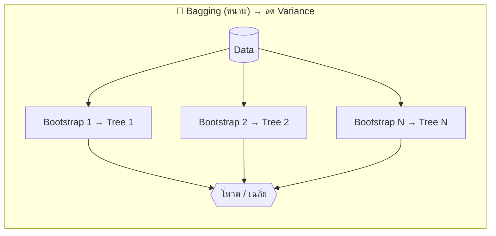

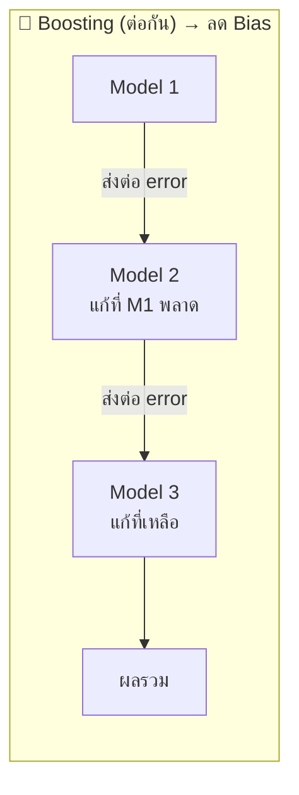

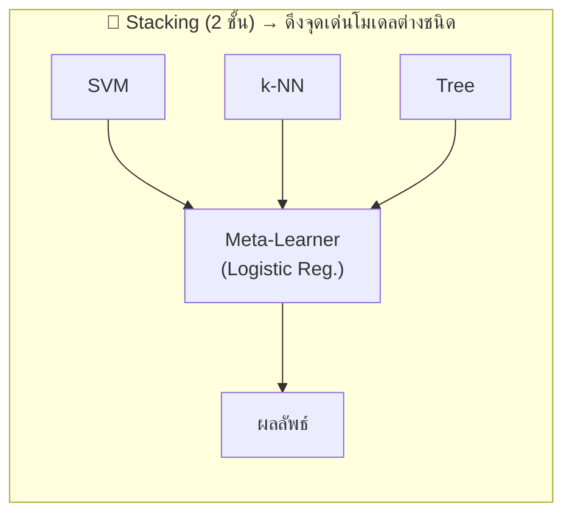

| | Bagging | Boosting | Stacking |
|---|---|---|---|
| การเทรน | ขนาน (Parallel) | ตามลำดับ (Sequential) | 2 ระดับ |
| โมเดลฐาน | ชนิดเดียวกัน | ชนิดเดียวกัน | **ต่างชนิดกัน** |
| เป้าหมาย | ลด **Variance** | ลด **Bias** | เพิ่มความแม่นรวม |
| วิธีจัดข้อมูล | สุ่มแบบใส่คืน | เพิ่มน้ำหนักข้อที่ทายผิด | ใช้ผลทำนายเป็น feature ใหม่ |
| ตัวอย่าง | Random Forest | AdaBoost, XGBoost, LightGBM | Stacked Classifier |

> [!example] เปรียบเทียบเป็นคน
> - **Bagging** = กรรมการ 100 คน แต่ละคนได้แฟ้มข้อมูลต่างกันนิดหน่อย แล้วโหวต
> - **Boosting** = นักเรียนทำข้อสอบ แล้วติวเฉพาะข้อที่ผิด รอบต่อไปติวข้อที่ยังผิดอยู่
> - **Stacking** = รัฐมนตรีฟังผู้เชี่ยวชาญ 3 สาขา แล้วเรียนรู้ว่าสถานการณ์ไหนควรเชื่อใคร

---

## 10.2 Random Forest

**สูตร: Random Forest = Bagging + สุ่ม Feature**

1. **Bootstrap Sampling** — สุ่มข้อมูลแบบ **ใส่คืน** ได้ชุดใหม่ขนาดเท่าเดิม (บางแถวซ้ำ บางแถวไม่ถูกเลือก = **Out-of-Bag** ใช้ประเมินได้)
2. **Random Subset of Features** — ทุกครั้งที่แตกกิ่ง สุ่ม feature มาพิจารณาแค่บางส่วน
   - Classification: $m \approx \sqrt{p}$ · Regression: $m \approx p/3$
3. **Aggregate** — Classification โหวต · Regression เฉลี่ย

> [!question] ทำไมต้องสุ่ม feature ด้วย ไม่ใช่แค่สุ่มข้อมูล?
> ถ้ามี feature เด่นมาก (เช่น "รายได้") ทุกต้นจะเลือกมันเป็น root หมด → ต้นไม้หน้าตาเหมือนกัน (correlated) → โหวตไปก็ไม่ช่วย
> การสุ่ม feature บังคับให้ต้นไม้ **แตกต่างกัน (Decorrelated)**

### Feature Importance
วัดว่า feature ช่วย **ลด Gini Impurity** ได้มากแค่ไหนเฉลี่ยในทุกต้น (Mean Decrease in Impurity) → ทำให้ Forest ที่เป็น Black-box ยัง **อธิบายได้บางส่วน**

> [!example] มข. ทำนายนักศึกษาพ้นสภาพ
> Importance: การเข้าเรียน 0.45 > GPAX ม.ปลาย 0.25 > การใช้ห้องสมุด 0.15 > คะแนนสอบเข้า 0.10
> → **Insight:** พฤติกรรมปัจจุบันบอกได้ดีกว่าคะแนนในอดีต → ทำระบบเตือนเมื่อขาดเรียนเกินกำหนด

| Hyperparameter | ความหมาย | Default |
|---|---|---|
| `n_estimators` | จำนวนต้นไม้ (เยอะ = เสถียร แต่ช้า) | 100 |
| `max_depth` | ความลึกของแต่ละต้น | None |
| `max_features` | จำนวน feature ที่สุ่มต่อการแตกกิ่ง | sqrt |
| `min_samples_split` | ข้อมูลขั้นต่ำก่อนแตกกิ่ง | 2 |

---

## 10.3 Single Tree vs Random Forest

| มิติ | Single Tree | Random Forest |
|---|---|---|
| Overfitting | สูง (High Variance) | ต่ำ (เฉลี่ยลด variance) |
| ความแม่นยำ | ปานกลาง (ตัวอย่าง: Test 85%) | สูงกว่า (ตัวอย่าง: Test 93%) |
| อธิบายผล | ✅ White-box วาดเป็น flowchart ได้ | ⚠️ Black-box (แต่มี Feature Importance) |
| ความเร็วทำนาย | เร็วมาก | ช้ากว่า M เท่า (M = จำนวนต้น) |
| หน่วยความจำ | น้อย | มาก |
| Parallel | ไม่ได้ | ได้ (`n_jobs=-1`) |

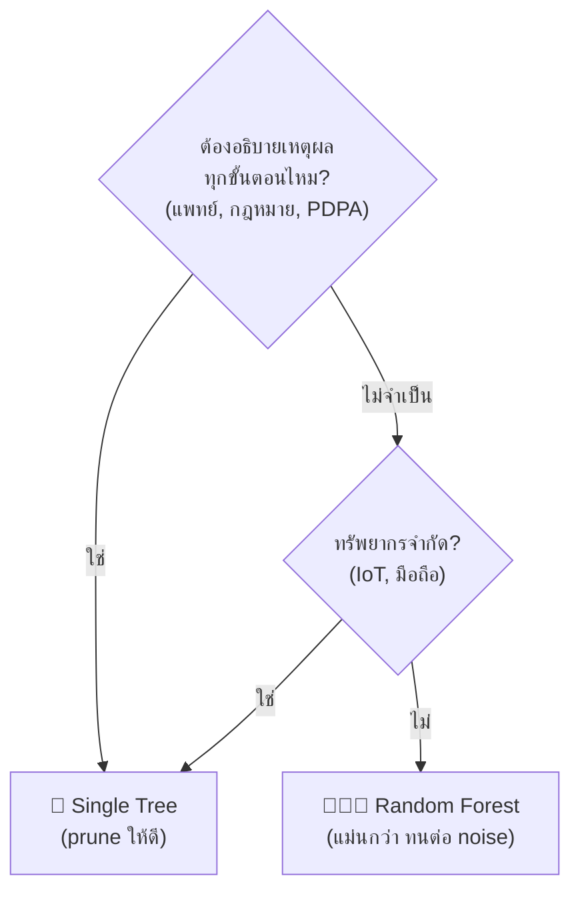

---

## 10.4 Gradient Boosting

> [!info] ไอเดีย: สร้างต้นไม้ทีละต้น แต่ละต้นแก้ **Residual** ที่ต้นก่อนหน้าทำพลาด
> $$F_m(x) = F_{m-1}(x) + \eta \cdot h_m(x)$$
> - $h_m$ = ต้นไม้ตื้น ๆ (Weak Learner) ที่ทำนาย residual
> - $\eta$ = **Learning Rate** (ก้าวเล็ก = ช้าแต่แม่น)

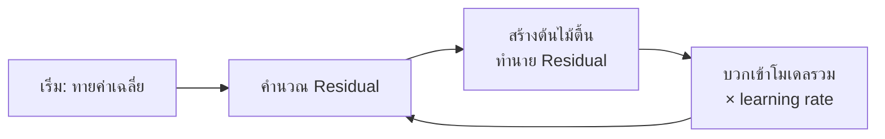

| ไลบรารี | จุดเด่น | เหมาะกับ |
|---|---|---|
| **XGBoost** | มี Regularization, จัดการ Missing value ได้ | ข้อมูลขนาดกลาง, Kaggle |
| **LightGBM** | Histogram-based → **เร็วมาก** | ข้อมูลใหญ่ (>100K แถว) |
| **CatBoost** | จัดการ Categorical ได้เลยไม่ต้อง encode | ข้อมูลหมวดหมู่เยอะ |

![[ds-10-bag-boost.png]]

> [!danger] ต่างจาก Random Forest สำคัญ!
> Gradient Boosting **Overfit ได้** ถ้า `n_estimators` เยอะเกิน → ต้องใช้ **Early Stopping** กับ Validation set
> (Random Forest เพิ่มต้นไม้เท่าไหร่ก็ไม่ overfit แค่เปลืองเวลา)

| | Random Forest | Gradient Boosting |
|---|---|---|
| โครงสร้าง | ขนาน | ลำดับขั้น |
| ต้นไม้ | ลึก (low bias, high var) | **ตื้น** (weak learner) |
| ลด | Variance | Bias |
| Tuning | ง่าย ไม่ไวต่อค่า | ยาก ไวต่อ learning rate/depth |
| แม่นยำ | ดี | ดีกว่าเล็กน้อย (ถ้า tune ดี) |

> [!tip] เลือกใช้ในทางปฏิบัติ
> - ข้อมูลเล็ก / อยากได้ Baseline เร็ว → **Random Forest**
> - อยากแม่นสุด มีเวลา tune → **XGBoost/LightGBM + Early Stopping**
> - ข้อมูลใหญ่มาก → **LightGBM** · Categorical เยอะ → **CatBoost**

---

## 10.5 ตีความและนำเสนอผล Ensemble

**กรอบ 3 ขั้น: Data → Insight → Action**

| Feature Importance | Insight | Action |
|---|---|---|
| จำนวนร้องเรียน = 0.35 | ร้องเรียนเยอะ ยิ่งเลิกใช้ | ปรับปรุง Call Center |
| ค่าบริการ/เดือน = 0.20 | ค่าบริการสูงเสี่ยงเลิก | เสนอแพ็กเกจส่วนลด |
| ระยะเป็นลูกค้า = 0.18 | ลูกค้าใหม่เลิกง่าย | โปรแกรม Onboarding |

**Template นำเสนอผู้บริหาร:** Problem → Findings → Confidence → Recommendations

> [!example] พูดภาษาธุรกิจ ไม่ใช่ภาษา Algorithm
> ❌ "XGBoost max_depth=4 lr=0.1 ได้ AUC-ROC 0.92"
> ✅ "ระบบระบุลูกค้าเสี่ยงยกเลิกได้แม่น 85% ล่วงหน้า 30 วัน คาดว่าลดการสูญเสียได้ ~17 ล้านบาท/ไตรมาส"

> [!warning] ระวัง Data Leakage
> ถ้า feature สำคัญสุดคือสิ่งที่เกิด **หลัง** เหตุการณ์ (เช่น จำนวนธุรกรรมพุ่งเพราะกำลังจะยกเลิก) → โมเดลกำลังโกง

> [!summary] สรุปบทที่ 10
> - Ensemble = รวมหลายโมเดลที่ **หลากหลาย** → แม่นและเสถียรกว่า
> - Bagging (RF) ลด Variance · Boosting (XGB/LGBM) ลด Bias · Stacking ผสมโมเดลต่างชนิด
> - RF = Bootstrap + สุ่ม feature, ไม่ overfit เมื่อเพิ่มต้น
> - GBM = แก้ residual ทีละรอบ, **ต้อง Early Stopping**
> - สื่อสารผลด้วย Feature Importance → Insight → Action

---

# บทที่ 11 Clustering — การจัดกลุ่มข้อมูล

## 11.1 Unsupervised Learning

> [!info] นิยาม
> เรียนรู้จากข้อมูลที่ **ไม่มี Label (ไม่มี y)** — มีแค่ X แล้วหา **โครงสร้าง/รูปแบบที่ซ่อนอยู่**

| | Supervised | Unsupervised |
|---|---|---|
| Input | X และ y | **X อย่างเดียว** |
| เป้าหมาย | ทำนาย | **สำรวจ / จัดกลุ่ม** |
| ประเมินผล | ชัดเจน (Accuracy, RMSE) | **ยาก มีความเป็นอัตวิสัย** |
| เตรียมข้อมูล | ต้อง Label (แพง) | ใช้ข้อมูลดิบได้เลย |
| งาน | Classification, Regression | Clustering, Dimensionality Reduction, Association Rules |

**Use Cases:**
- 🛒 **Customer Segmentation** — Shopee/Lazada พบกลุ่ม "ล่าโค้ดส่งฟรีตอนเที่ยงคืน"
- 🚨 **Anomaly Detection** — สปสช. หาคลินิกเบิกยาสูงผิดปกติ (โดยไม่ต้องมีประวัติทุจริตมาก่อน)
- 📝 **Topic Modeling (LDA)** — สรุปความเห็นนักศึกษาหลายหมื่นข้อความเป็นหัวข้อ เช่น {แอร์, ร้อน, ซ่อม}

| ✅ ข้อดี | ❌ ข้อจำกัด |
|---|---|
| ไม่ต้อง Label → ประหยัด | ประเมินยาก ไม่มีคำตอบที่ถูก |
| ค้นพบสิ่งที่คาดไม่ถึง | โมเดลบอกแค่ "กลุ่ม 1, 2" — **คนต้องตีความเอง** |
| ใช้เป็น preprocessing (เช่น PCA) | บางอัลกอริทึมคำนวณหนักเมื่อข้อมูลใหญ่ |

---

## 11.2 K-Means Algorithm

**เป้าหมาย:** แบ่งเป็น K กลุ่ม ให้ **WCSS (Inertia)** น้อยที่สุด

$$WCSS = \sum_{k=1}^{K}\sum_{x_i \in C_k} \|x_i - \mu_k\|^2$$

(= ผลรวมระยะ² จากทุกจุดถึงจุดศูนย์กลางกลุ่มตัวเอง)

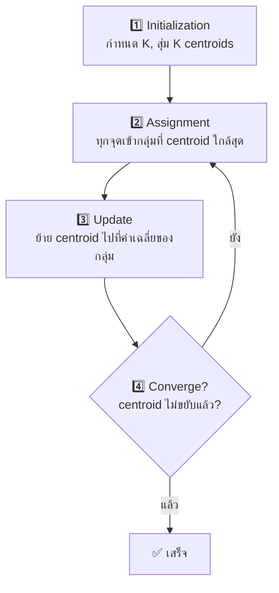

![[ds-11-kmeans.png]]

> [!danger] Feature Scaling = บังคับ!
> K-Means ใช้ระยะ Euclidean — อายุ (18–60) vs ยอดซื้อ (5,000–500,000 บาท) ไม่ scale = จัดกลุ่มตามยอดซื้ออย่างเดียว

> [!warning] Random Initialization Trap
> สุ่มจุดเริ่มไม่ดี → ติด **Local Optimum**
> แก้ด้วย: **K-Means++** (สุ่มจุดถัดไปให้ห่างจากจุดเดิม) + **`n_init=10`** (รันหลายรอบเลือกอันที่ WCSS ต่ำสุด)

**หยุดเมื่อ:** centroid ไม่เปลี่ยน (หรือเปลี่ยนน้อยกว่า `tol`) · ไม่มีจุดย้ายกลุ่ม · ครบ `max_iter` (default 300)

---

## 11.3 การเลือก K

![[ds-11-chooseK.png]]

| วิธี | หลักการ | ✅ | ❌ |
|---|---|---|---|
| **Elbow Method** | Plot WCSS vs K หาจุด "ข้อศอก" ที่เริ่มลดช้าลง | เข้าใจง่าย เร็ว | ข้อมูลจริงมักไม่มีข้อศอกชัด |
| **Silhouette Score** | วัดทั้ง **เกาะกลุ่ม** และ **แยกห่าง** ค่า −1 ถึง 1 | ตัวเลขชัด | ช้า $O(N^2)$, ชอบกลุ่มทรงกลม |
| **Domain Knowledge** | เลือกตามข้อจำกัดธุรกิจ | ใช้งานได้จริง | อาจมีอคติมนุษย์ |

**Silhouette:** $s(i) = \dfrac{b(i) - a(i)}{\max(a(i), b(i))}$
- $a$ = ระยะเฉลี่ยถึงเพื่อนในกลุ่มตัวเอง (ยิ่งน้อยยิ่งดี)
- $b$ = ระยะเฉลี่ยถึงกลุ่มที่ใกล้ที่สุดถัดไป (ยิ่งมากยิ่งดี)
- ใกล้ 1 = ดีมาก · ใกล้ 0 = อยู่ตรงรอยต่อ · ใกล้ −1 = อยู่ผิดกลุ่ม

> [!warning] WCSS ลดลงเสมอเมื่อเพิ่ม K
> K = จำนวนจุดข้อมูล → WCSS = 0 แต่ไร้ประโยชน์ เลยดู WCSS อย่างเดียวไม่ได้

> [!example] สถิติ vs ธุรกิจ
> Silhouette แนะนำ K=6 แต่ฝ่ายการตลาดมีงบทำแคมเปญได้แค่ 3 แบบ (บัตรเงิน/ทอง/แพลตินัม) → เลือก **K=3**
> **แนวปฏิบัติ:** ใช้สถิติหาช่วง K ที่เป็นไปได้ (เช่น 3–5) แล้วคุยกับผู้เชี่ยวชาญเลือกค่าสุดท้าย

---

## 11.4 Cluster Profiling — ทำให้ "กลุ่ม 0, 1, 2" มีความหมาย

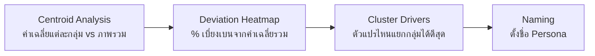

1. **Centroid Analysis** — เทียบค่าเฉลี่ยของกลุ่มกับ Global Mean
2. **Deviation Heatmap** — $\text{Deviation \%} = \frac{\text{Cluster Mean} - \text{Global Mean}}{\text{Global Mean}} \times 100$ → แดง = สูงกว่าเฉลี่ย, น้ำเงิน = ต่ำกว่า, ขาว = ปกติ
3. **Cluster Drivers** — เทรน Random Forest ให้ **ทำนาย Cluster Label** แล้วดู Feature Importance → ตัวที่ importance สูง = ตัวที่แยกกลุ่ม
4. **Naming** — ตั้งชื่อสั้น จำง่าย สะท้อนพฤติกรรม ไม่ใช้คำลบเกินจำเป็น

| Cluster | ลักษณะ (RFM) | ชื่อ | กลยุทธ์ |
|---|---|---|---|
| 0 | ซื้อไม่บ่อย ยอดปานกลาง | 🙂 Standard | โปรกระตุ้นซื้อซ้ำ |
| 1 | หายไปนานมาก | ⚠️ At-Risk / Churned | ส่วนลดจำกัดเวลา ดึงกลับ |
| 2 | ซื้อบ่อย ยอดสูง เพิ่งซื้อ | 👑 Champions / VIP | Loyalty program, บริการพรีเมียม |

---

## 11.5 การทดสอบทางสถิติสำหรับ Clusters

> [!question] ทำไมต้องทดสอบ?
> K-Means **แบ่งกลุ่มให้เสมอ** แม้ข้อมูลไม่มีกลุ่มจริง → ต้องพิสูจน์ว่ากลุ่มต่างกันจริง ไม่ใช่บังเอิญ

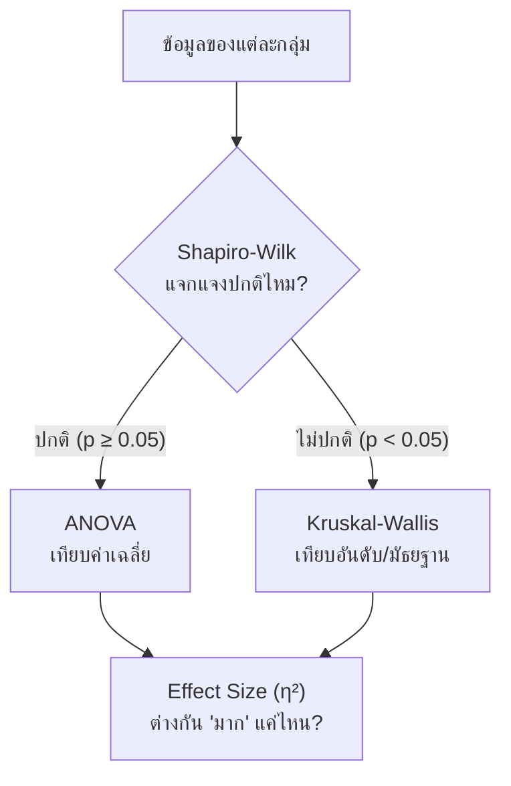

| | ANOVA | Kruskal-Wallis |
|---|---|---|
| ประเภท | Parametric | Non-parametric |
| เปรียบเทียบ | Mean | Median / Rank |
| ต้องปกติ | ✅ | ❌ |
| Outlier | อ่อนไหว | ทนทาน |
| เหมาะกับ | คะแนนสอบ | **ข้อมูลธุรกิจที่เบ้ (ยอดเงิน)** |

**Effect Size** $\eta^2 = \frac{SS_{between}}{SS_{total}}$ → 0.01 เล็ก · 0.06 กลาง · ≥ 0.14 ใหญ่

> [!danger] p-value ≠ Practical Significance
> ลูกค้า 1 ล้านคน: กลุ่ม A ซื้อเฉลี่ย 1,500 บาท กลุ่ม B 1,505 บาท → p = 0.001 (ต่างอย่างมีนัยสำคัญ!)
> แต่ต่างแค่ **5 บาท** ไม่คุ้มทำแคมเปญแยก → ข้อมูลใหญ่ทำให้ p เล็กเสมอ **ต้องดู Effect Size ด้วย**
> ⚠️ Shapiro-Wilk กับข้อมูลใหญ่มากจะปฏิเสธเกือบทุกครั้ง → ดู Q-Q plot / Histogram ประกอบ

---

## 11.6 Storytelling & Domain Expert

| | Data Scientist | Domain Expert |
|---|---|---|
| เตรียมข้อมูล | Clean, Scale, Encode | บอกว่าตัวแปรไหนสำคัญทางธุรกิจ |
| เลือกโมเดล | อัลกอริทึม, tune | กำหนดข้อจำกัด (ดูแลได้กี่กลุ่ม) |
| ประเมิน | Silhouette, Davies-Bouldin | **ความหมาย + นำไปใช้ได้จริง** |
| ใช้งาน | สร้าง pipeline | ออกแบบกลยุทธ์ต่อแต่ละกลุ่ม |

**Validate กลุ่มด้วย 3 คำถาม:**
1. **Interpretability** — อธิบายเป็นภาษาคนได้ไหม?
2. **Distinctiveness** — ต่างกันในมุมธุรกิจไหม? (ถ้ากลยุทธ์เหมือนกัน → รวมกลุ่ม)
3. **Actionability** — ทำอะไรกับกลุ่มนี้ได้ไหม?

> [!example] Persona บัตรเครดิต
> - 🎒 **First-Jobbers** — รายได้เริ่มต้น ใช้บัตรบ่อยแต่ยอดน้อย (กาแฟ, BTS) → "ใช้ครบ 10 ครั้งรับเงินคืน"
> - 🏦 **Conservative Wealth** — รายได้สูงมาก แต่ใช้น้อย → RM เสนอ Wealth Management, Airport Lounge
> - 🛍️ **Lifestyle Shoppers** — ใช้จ่ายสูงมาก → ผ่อน 0% 3 เดือน, ร่วมห้างชั้นนำ

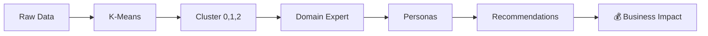

> [!summary] สรุปบทที่ 11
> - Unsupervised = ไม่มี label, หาโครงสร้างเอง
> - K-Means: Assign ↔ Update วนจนนิ่ง · **ต้อง Scale** · ใช้ K-Means++ + n_init
> - เลือก K: Elbow + Silhouette + **Domain Knowledge**
> - Profiling: Centroid → Heatmap → Drivers → Naming
> - ทดสอบ: Shapiro → ANOVA/Kruskal-Wallis → **Effect Size** (p-value อย่างเดียวไม่พอ)

---

# บทที่ 12 Model Validation & Selection

## 12.1 Cross-Validation

> [!warning] Single Train-Test Split ไม่พอ
> แค่เปลี่ยน `random_state` ความแม่นยำก็แกว่งจาก **87.7% ถึง 96.5%** → ขึ้นกับดวงว่าข้อมูลไหนไปอยู่ใน test

### K-Fold Cross-Validation

![[ds-12-kfold.png]]

- แบ่งข้อมูลเป็น K ส่วน หมุนเวียนให้แต่ละส่วนเป็น validation 1 ครั้ง → ได้ K คะแนน
- นิยม **K = 5 หรือ 10** (สมดุล bias/variance/เวลา)
- ข้อมูล **ทุกแถว** ได้เป็นทั้ง train และ test

| วิธี | ใช้เมื่อ |
|---|---|
| **K-Fold** | ทั่วไป |
| **Stratified K-Fold** | **ข้อมูลไม่สมดุล** — ทุก fold รักษาสัดส่วนคลาสเท่าข้อมูลจริง (เช่นทุจริต 0.1%) |
| **LOOCV** (K = N) | ข้อมูลน้อยมาก (เช่น ผู้ป่วยโรคหายาก 40 ราย) — ไม่ bias แต่ช้ามาก |
| **Time Series Split** | ข้อมูลตามเวลา — เทรนอดีต ทดสอบอนาคต |

### รายงานด้วย Mean ± Std

| โมเดล | คะแนน 5 folds | Mean ± Std | ตีความ |
|---|---|---|---|
| A (Logistic) | 0.82, 0.81, 0.83, 0.82, 0.82 | **0.82 ± 0.007** | ปานกลาง แต่ **เสถียรมาก** |
| B (Deep NN) | 0.95, 0.70, 0.98, 0.65, 0.92 | **0.84 ± 0.137** | เฉลี่ยสูงกว่าแต่ **แกว่งมาก** เสี่ยง |

> [!tip] คำถามที่ถูก
> ไม่ใช่ "โมเดลไหนคะแนนสูงสุด?" แต่คือ **"โมเดลไหนเชื่อถือได้ที่สุด?"** → เลือก A

---

## 12.2 Hyperparameter Tuning

| | **Parameters** | **Hyperparameters** |
|---|---|---|
| ที่มา | โมเดล **เรียนรู้เอง** จากข้อมูล | **เรากำหนด** ก่อนเทรน |
| ตัวอย่าง | β ใน Linear Reg., จุดแบ่งในต้นไม้ | k ใน k-NN, max_depth, learning rate, alpha |

| วิธีค้นหา | หลักการ | ✅ | ❌ |
|---|---|---|---|
| **GridSearchCV** | ลอง **ทุกชุด** ที่กำหนด + CV | ครบ เจอดีสุดในกรอบ | ช้าแบบทวีคูณ |
| **RandomizedSearchCV** | สุ่มลองตามจำนวนรอบ | เร็ว คุมเวลาได้ มักดีพอ | อาจพลาดจุดดีสุด |
| **Bayesian Optimization** | เรียนรู้จากรอบก่อน เลือกจุดถัดไปอย่างฉลาด | ใช้รอบน้อย | ซับซ้อน |

> [!example] นับรอบ Grid Search
> 3 (n_estimators) × 4 (max_depth) × 3 (min_samples_split) = **36 ชุด** × 5 folds = **180 รอบ**

> [!tip] เลือก `scoring` ให้ตรงงาน
> ข้อมูลไม่สมดุล (เช่น ผู้ป่วย readmit 20%) → ใช้ `scoring='f1'` ไม่ใช่ `'accuracy'`

---

## 12.3 Model Selection & Pipeline

### Occam's Razor 🪒
> [!quote] ถ้าโมเดลง่ายกับโมเดลซับซ้อนแม่นพอ ๆ กัน → **เลือกโมเดลง่าย**
> เหตุผล: อธิบายได้, ถูกกว่า, generalize ดีกว่า
> ตัวอย่าง: Logistic 85% vs Deep NN 86% (ใช้ 50 ตัวแปร) → เลือก Logistic ให้อาจารย์ที่ปรึกษาเข้าใจว่าทำไมเด็กเสี่ยง

### 🚨 Data Leakage — ข้อมูลรั่ว
ข้อมูลจาก test **แอบรั่ว** เข้าไปตอนเทรน → คะแนนสูงเกินจริง → ใช้งานจริงพัง

| ❌ ผิด | ✅ ถูก |
|---|---|
| Scale ข้อมูลทั้งหมด → แล้วค่อยแบ่ง | แบ่งก่อน → `fit` scaler ด้วย train **เท่านั้น** → `transform` ทั้ง train/test |

> [!danger] ผลกระทบจริงในบท
> ทำ Feature Selection ก่อนแบ่ง → ได้ **88%** · ทำใน Pipeline (ถูก) → ได้ **73%** → เกินจริงถึง **15%**!

### Pipeline = สายพานที่มัดทุกขั้นตอนเข้าด้วยกัน

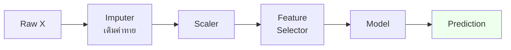

ประโยชน์: **กัน Leakage อัตโนมัติใน CV** · deploy ง่าย (preprocessing ติดไปด้วย) · tune ได้ทั้ง pipeline

### Reproducibility — ทำซ้ำได้ผลเดิม
1. ตั้ง **Random Seed / `random_state`** เสมอ
2. บันทึก **เวอร์ชันไลบรารี** (`requirements.txt`, Docker)
3. เก็บ **Snapshot ข้อมูล** (Data Version Control)

> ตัวอย่าง: AI อ่าน X-ray ของ รพ.ศรีนครินทร์ รัน 3 ครั้งได้ผลไม่เท่ากัน → ไม่ผ่านการรับรอง อย.

---

## 12.4 Learning Curves — วินิจฉัยโรคของโมเดล

![[ds-12-learning.png]]

| รูปแบบ | วินิจฉัย | วิธีแก้ |
|---|---|---|
| Train สูง, Validation ต่ำ (**gap กว้าง**) | **Overfitting** (High Variance) | เพิ่มข้อมูล, ลดความซับซ้อน, Regularize |
| ทั้งคู่ต่ำ (**gap แคบ**) | **Underfitting** (High Bias) | เพิ่มความซับซ้อน, เพิ่ม feature, ลด Regularization |
| ทั้งคู่สูงและใกล้กัน | **Good Fit** | 👍 |

> [!tip] ใช้ตอบคำถามธุรกิจ: "ควรลงทุนเก็บข้อมูลเพิ่มไหม?"
> - Validation ยัง **ไต่ขึ้น** เมื่อเพิ่มข้อมูล → คุ้มที่จะเก็บเพิ่ม
> - Validation **ราบ (plateau)** แล้ว → อย่าเสีย 5 ล้านเก็บข้อมูล ไปปรับ feature/โมเดลแทน

> [!summary] สรุปบทที่ 12
> - CV (K-Fold / Stratified / LOOCV) → รายงาน **Mean ± Std**
> - Parameters (เรียนเอง) vs Hyperparameters (เราตั้ง) → Grid / Random / Bayesian Search
> - Occam's Razor · **Pipeline กัน Data Leakage** · Reproducibility (seed, version, data)
> - Learning Curve บอก Overfit/Underfit และบอกว่าควรเก็บข้อมูลเพิ่มไหม

---

# บทที่ 13 Data Storytelling และการเขียนรายงาน

## 13.1 Model Deployment Basics

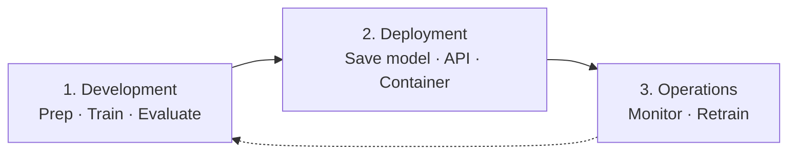

### บันทึกโมเดล (Serialization)
| | `pickle` | `joblib` |
|---|---|---|
| คืออะไร | มาตรฐาน Python | เน้น NumPy array |
| กับ scikit-learn | ใช้ได้ | **แนะนำ** เร็วกว่า ไฟล์เล็กกว่า |

> [!danger] ห้ามโหลดไฟล์โมเดลจากแหล่งไม่น่าเชื่อถือ — รันโค้ดอันตรายได้

### API — "พนักงานเสิร์ฟ" ของโมเดล
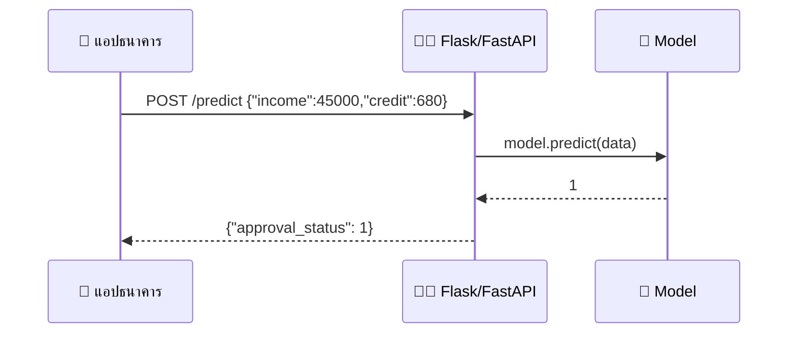
- รับส่งข้อมูลเป็น **JSON** · ใช้ **Flask** / **FastAPI** (+ Pydantic ตรวจรูปแบบข้อมูล) · ต้องมี `try-except` กันระบบล่ม
- ทำ Prototype เร็ว ๆ ให้ผู้ใช้ลอง → **Streamlit / Gradio**

### MLOps — โมเดล "เสื่อม" ได้ (Model Decay)

| | Data Drift | Concept Drift |
|---|---|---|
| อะไรเปลี่ยน | **การแจกแจงของ X** | **ความสัมพันธ์ X → y** |
| ตัวอย่าง | ผู้ป่วยอายุเฉลี่ยสูงขึ้น | พฤติกรรมช้อปเปลี่ยนสิ้นเชิงช่วง COVID |

**Monitoring:** Operational (latency, error rate) · ML metrics (ระวัง ground truth มาช้า) · Data quality
**Retraining:** ตามรอบเวลา · เมื่อ metric ตก · เมื่อเจอ drift (เช่น KS-test)

---

## 13.2 Data Storytelling

> [!info] Data + Narrative + Visuals = Change
> ```
>          [ Data ]
>         /        \
>    Explain      Enlighten
>       /            \
> [Narrative] ---- [Visuals]
>           Engage
> ```

### กรอบ CDNA: Context → Data → Narrative → Action

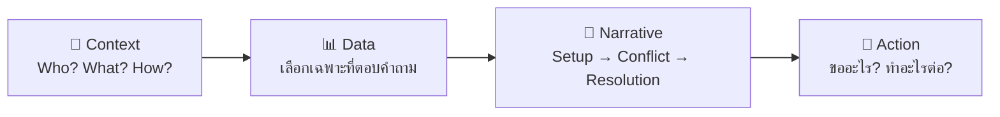

> [!example] Story Arc
> - **Setup:** ปี 2566 การใช้ e-Learning มข. เพิ่ม 20%
> - **Conflict:** ระบบล่มช่วงสอบมิดเทอม กระทบ 5,000 คน
> - **Resolution:** คอขวดอยู่ที่ฐานข้อมูลเก่า → ย้ายขึ้น Cloud
> - **Action:** ขออนุมัติงบ 500,000 บาท ภายในไตรมาส 3

**Exploratory vs Explanatory:** EDA = เราสำรวจทุกอย่าง · นำเสนอ = **เลือกเฉพาะที่ตอบคำถาม**

### Tufte & Data-Ink Ratio

$$\text{Data-Ink Ratio} = \frac{\text{หมึกที่แสดงข้อมูลจริง}}{\text{หมึกทั้งหมด}} \rightarrow \text{ให้เข้าใกล้ 1}$$

![[ds-13-dataink.png]]

กำจัด **Chartjunk**: gridline หนา, พื้นหลังสี, เส้นขอบ, 3D, เงา · ใช้ **Direct Labeling** แทนแกน Y

### Preattentive Attributes — สิ่งที่สมองเห็นใน < 250 ms
| กลุ่ม | ตัวอย่างใช้ |
|---|---|
| **Color** (hue, intensity) | แดงเฉพาะ รพ. ที่รอ ER เกิน 4 ชม. ที่เหลือเทา |
| **Form** (length, size, shape) | ความยาวแท่ง, ขนาดวงกลม, × แทน outlier |
| **Spatial** (position, grouping) | ตำแหน่งใน scatter, จัดกลุ่มกราฟ |

### 1 Slide = 1 Message
| | Traditional | Storytelling |
|---|---|---|
| หัวข้อ | "สถิติผู้ป่วยไข้เลือดออก ปี 2566" | **"ผู้ป่วยไข้เลือดออกพุ่งสูงสุดในเดือนสิงหาคม"** (Action Title) |
| เนื้อหา | Bullet 5 ข้อ | กราฟเส้น 1 อัน เน้นจุดสูงสุด |
| กราฟ | 3D สีเยอะ + ตาราง | 2D เรียบ มี annotation |

---

## 13.3 Misleading Visualizations — กราฟหลอกตา

| ประเภท | ปัญหา | ทางแก้ |
|---|---|---|
| **Truncated Axis** | Bar chart แกน Y ไม่เริ่มที่ 0 → ต่างนิดเดียวดูต่างมหาศาล | Bar chart เริ่ม 0 เสมอ |
| **Cherry-picking** | เลือกเฉพาะช่วงที่ดี (เช่น PM2.5 เชียงใหม่แค่หน้าฝน) | แสดงรอบเต็ม / YoY |
| **3D Charts** | มุมมองบิดเบือน ชิ้นหน้าดูใหญ่ | ใช้ 2D bar |
| **Dual Axes** | ปรับสเกลบังคับให้เส้นทับกัน → **ความสัมพันธ์ลวง** (ไอศกรีม vs ไข้เลือดออก — ตัวกวนคือฤดู) | แยก subplot / ใช้ % change |

![[ds-13-truncated.png]]

> [!important] Lie Factor (Tufte)
> $$\text{Lie Factor} = \frac{\text{ขนาดผลที่แสดงในกราฟ}}{\text{ขนาดผลจริงในข้อมูล}}$$
> = 1 ซื่อตรง · > 1.05 หรือ < 0.95 = บิดเบือน
> หลักจริยธรรม: **Proportionality · Complete Context · Clear Labeling**

---

## 13.4 การเขียนรายงาน Data Science

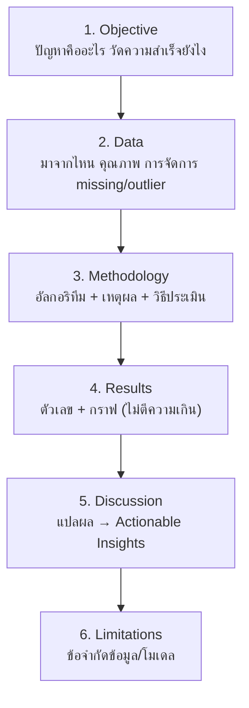

- **Executive Summary**: ปัญหา–วิธี–ผล–ข้อเสนอแนะ ภาษาง่าย วางไว้ **ต้น** รายงาน
- **Limitations ไม่ใช่ความล้มเหลว** แต่คือความโปร่งใส

**Reproducible Notebook:** ล็อกเวอร์ชันไลบรารี · ตั้ง seed · รันได้ตั้งแต่ต้นจนจบ (**Restart & Run All**)

**อ้างอิง & License:**
- อ้างอิงข้อมูล/โค้ดทุกครั้ง (รวมโค้ดจาก Stack Overflow / AI)

| License | ใช้เชิงพาณิชย์ | เงื่อนไขหลัก |
|---|---|---|
| MIT | ✅ | แนบข้อความลิขสิทธิ์เดิม |
| GPLv3 | ✅ | งานดัดแปลงต้องเป็น GPL ด้วย (Copyleft) |
| Apache 2.0 | ✅ | คล้าย MIT + ระบุเรื่องสิทธิบัตร |
| CC BY 4.0 | ✅ | ต้องให้เครดิต |
| CC BY-**NC** | ❌ | ห้ามใช้เชิงพาณิชย์ |

> [!summary] สรุปบทที่ 13
> - Deploy: joblib → API (Flask/FastAPI) → Monitor drift → Retrain
> - Storytelling: **Context → Data → Narrative → Action**, Data-Ink ratio, Preattentive, 1 slide = 1 message
> - กราฟหลอก: Truncated axis, Cherry-pick, 3D, Dual axes → วัดด้วย Lie Factor
> - รายงาน 6 ส่วน: Objective, Data, Method, Results, Discussion, Limitations

---

# บทที่ 14 โครงงาน Data Science แบบ End-to-End

## 14.1 DS Project Lifecycle (6 ขั้น, วนซ้ำ)

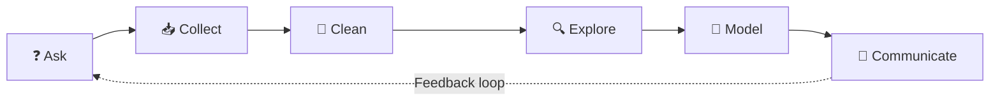

| ขั้น | ทำอะไร | ตัวอย่าง |
|---|---|---|
| **Ask** | แปลงปัญหาธุรกิจ → ปัญหา DS + ตั้ง Success Metric | "ช่วยเด็กเสี่ยงพ้นสภาพ" → Classification ทำนาย GPA < 2.00 เน้น **Recall** |
| **Collect** | DB, API, Web Scraping, ไฟล์ | ธุรกรรมธนาคาร, รีวิว e-commerce, EHR |
| **Clean** | missing, ซ้ำ, outlier, format | **กินเวลา 70–80%** ของโครงการ |
| **Explore** | สถิติเชิงพรรณนา + กราฟ หา pattern | ชั่วโมงอ่าน vs คะแนนสอบ |
| **Model** | แบ่ง train/test, เลือกโมเดล, tune, ประเมิน | RF ทำนาย Churn |
| **Communicate** | แปลเป็นภาษาธุรกิจ | "AUC 0.89" → "ลด NPL ~50 ล้าน/ปี" |

> [!check] Project Planning Checklist
> 1. **Business:** ปัญหาคืออะไร? Definition of Done? ผลใช้ยังไง (report/API)?
> 2. **Data:** อยู่ไหน? มีสิทธิ์ไหม? **ติด PDPA ไหม?** พอไหม?
> 3. **Method:** Supervised/Unsupervised? **Baseline** ตอนนี้เท่าไหร่? มี bias ไหม?
> 4. **Evaluation:** Metric ไหนตรงเป้า? ต้นทุน FP vs FN?
> 5. **Deployment:** ระบบปลายทางใช้อะไร? Retrain บ่อยแค่ไหน?

> [!danger] Common Pitfalls
> - **Data Leakage** — ใช้ข้อมูลอนาคตทำนายอดีต
> - **ไม่มี Baseline** — กระโดดไป Deep Learning โดยไม่รู้ว่าคุ้มไหม
> - **ลืมบริบทธุรกิจ** — แม่นขึ้น 1% แต่ช้า 10 วิ/คำขอ ใช้จริงไม่ได้
> - **Overfitting**

---

## 14.2 ตัวอย่าง Regression: ทำนายราคาบ้าน (California Housing)

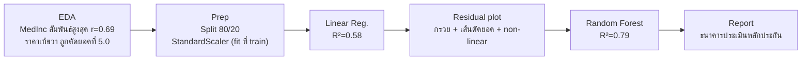

| โมเดล | RMSE | R² |
|---|---|---|
| Linear Regression | ~0.75 (~$74,500) | ~0.58 |
| **Random Forest** | **~0.52** | **~0.79** |

**Insight:** รายได้ในพื้นที่สำคัญสุด รองลงมาคือทำเล (lat/long) · RF จับความสัมพันธ์เชิงพื้นที่ที่เส้นตรงทำไม่ได้
**ข้อควรระวังที่รายงาน:** แม่นน้อยลงในบ้านหรู → ให้ผู้เชี่ยวชาญประเมินกลุ่มนี้

---

## 14.3 ตัวอย่าง Classification: Customer Churn (โทรคมนาคม)

> หาลูกค้าใหม่แพงกว่ารักษาลูกค้าเดิม **5–25 เท่า**

- **Prep:** One-Hot Encoding (Contract, InternetService) + StandardScaler ผ่าน `ColumnTransformer`
- **Models:** Decision Tree · k-NN · Random Forest
- **Metric:** เน้น **Recall** เพราะ FN (ปล่อยลูกค้าหลุด) แพงกว่า FP (ให้โปรฟรีคนที่ไม่ได้จะไป)

| | ลูกค้า Churn จริง | ไม่ Churn จริง |
|---|---|---|
| **ทายว่า Churn** | TP: ยื้อได้ตรงจุด ✅ | FP: เสียเงินให้โปรฟรี 💸 |
| **ทายว่าไม่ Churn** | FN: **เสียลูกค้าไปเงียบ ๆ** 🚨 | TN: ปกติ ✅ |

**ผลทั่วไป:** k-NN แย่สุด (categorical เยอะ) · Tree กลาง ๆ แต่อธิบายง่าย · **RF ดีสุด**

**Actionable:** สัญญารายเดือน + ใช้ไม่นาน + ค่าบริการสูง = เสี่ยง →
1. ชวนเปลี่ยนเป็นสัญญา 1–2 ปี (แลกส่วนลดเครื่อง)
2. **Early Warning**: P(churn) > 0.7 → Call center โทรหา
3. ทบทวนความคุ้มค่าแพ็กเกจพรีเมียม

> [!tip] งบโปรโมชันจำกัด? → เน้น **Precision** แทน (ให้โปรเฉพาะคนที่มั่นใจว่าจะไปจริง)

---

## 14.4 ตัวอย่าง Clustering: Customer Segmentation (RFM)

| ตัวแปร | ความหมาย | ดีเมื่อ |
|---|---|---|
| **R**ecency | กี่วันแล้วตั้งแต่ซื้อล่าสุด | **ต่ำ** = ดี |
| **F**requency | ซื้อกี่ครั้ง | สูง = ดี |
| **M**onetary | ยอดเงินรวม | สูง = ดี |

**ขั้นตอน:** StandardScaler → Elbow (K=4) + Silhouette (สูงสุด K=7 แต่เลือก **K=4** เพื่อให้ใช้งานได้จริง) → Deviation Heatmap → Kruskal-Wallis (p < 0.05 ทุกตัว ✅) → ตั้งชื่อ → กลยุทธ์

| Persona | ลักษณะ | กลยุทธ์ |
|---|---|---|
| 👑 **VIP / Champions** | ซื้อบ่อย ยอดสูง เพิ่งซื้อ | **ไม่ต้องลดราคา** ให้สิทธิพิเศษ (Early access, Exclusive event) |
| ⚠️ **Churning** | หายไปนาน | Win-back: ส่วนลดจำกัดเวลา, แบบสอบถาม |
| 🙂 **Regulars** | ปานกลางทุกด้าน | Loyalty program, Cross/Up-selling |
| 🌱 **Newbies** | เพิ่งเข้ามา ยอดน้อย | Onboarding, คูปองซื้อครั้งที่ 2 |

---

## 14.5 ตัวอย่าง EDA + Storytelling: PM2.5 กับผู้ป่วยทางเดินหายใจ (ขอนแก่น)

- **H₀:** ไม่มีความสัมพันธ์ · **Hₐ:** PM2.5 สูง → ผู้ป่วยมาก
- **ข้อมูล:** กรมควบคุมมลพิษ + HDC กระทรวงสาธารณสุข
- **สถิติ:** Pearson r = **0.88** (p ≈ 10⁻¹²) · T-test ฤดูฝุ่น vs ปกติ p ≈ 10⁻¹⁰ → **ปฏิเสธ H₀**
- **Visualization:** ไฮไลต์แถบสีเทา ก.พ.–เม.ย. ทุกปี + annotation จุดวิกฤต + ชื่อกราฟเป็นประโยคข้อค้นพบ

**Policy Recommendations:**
1. เตรียมยา/เครื่องช่วยหายใจ/เวรแพทย์เพิ่ม 30–40% ตั้งแต่ ม.ค.
2. Trigger อัตโนมัติ: PM2.5 > 75 µg/m³ ติดกัน 3 วัน → เรียนออนไลน์ / WFH
3. แจ้งเตือนล่วงหน้า 3 วันผ่าน LINE OA ให้กลุ่มเสี่ยง

---

## 14.6 LLM-Assisted DS Workflow

| ขั้น CRISP-DM | LLM ช่วยอะไร |
|---|---|
| Business Understanding | ระดมสมองปัจจัยที่มีผล |
| Data Understanding | แนะนำตัวแปรที่ควรเก็บ |
| Data Preparation | เขียนโค้ด clean |
| Modeling | แนะนำอัลกอริทึม / ช่วง hyperparameter |
| Evaluation | อธิบาย metric ให้ผู้บริหาร |
| Deployment | ร่าง API / documentation |

**Prompt ที่ดี = Role + Context & Data + Task + Output Format**

> [!example] Teachable Moment จากบท
> โค้ดที่ LLM ช่วยเขียนได้ Accuracy **97%** แต่ Recall คลาส Fail = **0.00** (มีเด็ก Fail แค่ 2 จาก 200)
> → AI ไม่เตือนเรื่อง Imbalanced Data ให้ **มนุษย์ต้องตรวจเอง**

> [!danger] ข้อควรระวัง
> - **Hallucination** — แต่งชื่อฟังก์ชันที่ไม่มีจริง / อ้างงานวิจัยปลอม
> - **Data Privacy** — ห้ามอัปโหลดข้อมูลจริงขึ้น LLM สาธารณะ (ผิด **PDPA**) ใช้ mock / anonymized
> - **Bias** ที่แฝงในโมเดล · **Reproducibility** (prompt เดิมคนละเวลาได้คำตอบต่าง)

```mermaid
flowchart LR
    H["🧑 Human Intention"] --> P["💬 Prompt"] --> D["📝 Draft Code"] --> V["🔎 Human Verify<br/>+ Official Docs<br/>+ Domain Knowledge"] --> X["✅ Execute & Deploy"]
```

**จริยธรรม:** ต้องเข้าใจทุกบรรทัด · **อ้างอิงการใช้ AI** (เช่น APA: OpenAI. (2024). ChatGPT …)

---

## 14.7 เทคนิคการนำเสนอ

```mermaid
flowchart LR
    A["1. Problem<br/>เริ่มที่ impact ไม่ใช่ชื่ออัลกอริทึม"] --> B["2. Data<br/>ขนาด · ตัวแปร · PDPA"] --> C["3. Method<br/>ลึกตามผู้ฟัง"] --> D["4. Result<br/>ไม่ใช่แค่ Accuracy"] --> E["5. Insight ⭐<br/>สำคัญที่สุด"] --> F["6. Limitations<br/>สร้างความน่าเชื่อถือ"]
```

> [!example] Insight ที่ดี
> "ปัจจัยสำคัญที่สุดที่ลูกค้าบัตรเครดิตเลิกใช้ **ไม่ใช่อายุหรือรายได้** แต่คือ 'จำนวนครั้งที่โทร Call Center' → ถ้าโทรเกิน 3 ครั้ง/สัปดาห์ ให้ผู้จัดการสาขาโทรกลับทันที"

**กราฟสำหรับนำเสนอ:** แนวนอนเรียงลำดับ · เน้นสีแค่ 1–2 แท่ง · ลบกรอบ · label ตรงแท่ง · ชื่อตัวแปรเป็นภาษาคน · ชื่อกราฟเป็นข้อสรุป

**Q&A:**
1. **Anticipate** — เตรียม Appendix slides
2. **Listen & Pause** — ฟังจนจบ หยุดคิด 2–3 วิ
3. **Clarify** — ทวนคำถาม
4. **"ไม่รู้"** — อย่าเดา: "ขอรับไปทดสอบเพิ่มแล้วแจ้งภายหลังครับ"

**Rubric ประเมิน:** Problem Definition · Methodology · Actionable Insights · Visual Design · Q&A (1–4 คะแนนแต่ละหัวข้อ)

---

## 14.8 Data Science ในอนาคต

| เทรนด์ | คืออะไร | ตัวอย่างไทย |
|---|---|---|
| **AutoML** (เช่น TPOT) | ทำ preprocessing → เลือกโมเดล → tune อัตโนมัติ | ระบบแนะนำสินค้าปรับเองทุกแคมเปญ |
| **LLM / Generative AI** | โมเดลภาษา (Transformer) | OpenThaiGPT, Chatbot ธนาคาร |
| **Edge Computing** | ประมวลผลใกล้แหล่งข้อมูล | Smart Farm เมล่อน ขอนแก่น บน Raspberry Pi |
| **Federated Learning** | ส่งแค่ **น้ำหนักโมเดล** ไม่ส่งข้อมูลดิบ | รพ.ศรีนครินทร์ + ศิริราช ร่วมเทรน X-ray โดยไม่ละเมิด PDPA |

```mermaid
flowchart TD
    S["🖥️ Central Server<br/>Global Model"] -->|"ส่งโมเดล"| A["🏥 รพ. A<br/>เทรนด้วยข้อมูลตัวเอง"]
    S -->|"ส่งโมเดล"| B["🏥 รพ. B<br/>เทรนด้วยข้อมูลตัวเอง"]
    A -->|"ส่งเฉพาะ weight update"| S
    B -->|"ส่งเฉพาะ weight update"| S
    N["🔒 ข้อมูลดิบไม่เคยออกจาก รพ."]
```

**Responsible AI:** Fairness (ลดอคติ) · Transparency/Explainability (SHAP, LIME) · Privacy & Security
**อาชีพใหม่:** Prompt Engineer · AI Ethics Officer / AI Governance Specialist
**แผนปฏิบัติการ AI แห่งชาติ (2565–2570):** จริยธรรม & กฎหมาย · โครงสร้างพื้นฐาน · กำลังคน · R&D (Thai NLP, เกษตร) · การประยุกต์ (แพทย์, เกษตร, ภาครัฐ)

> [!summary] สรุปบทที่ 14
> - Lifecycle: Ask → Collect → Clean → Explore → Model → Communicate (วนซ้ำ)
> - 4 ตัวอย่าง: บ้าน (Regression), Churn (Classification), RFM (Clustering), PM2.5 (EDA + Stats + Story)
> - LLM เป็น **ผู้ช่วย** ไม่ใช่ผู้แทน — Human-in-the-loop, ระวัง hallucination & PDPA
> - นำเสนอ: Problem → Data → Method → Result → **Insight** → Limitations

---

# 🧠 Cheat Sheet รวมทุกบท

## เลือกเทคนิคให้ถูกงาน
```mermaid
flowchart TD
    S{"มี Label (y) ไหม?"} -->|ไม่มี| CL["Clustering<br/>K-Means → Scale ก่อน!"]
    S -->|มี| T{"y เป็นอะไร?"}
    T -->|ตัวเลข| RG["Regression<br/>Linear → Ridge/Lasso → RF/XGB"]
    T -->|หมวดหมู่| CF["Classification<br/>Logistic (baseline) → Tree/kNN → RF/XGB"]
    RG --> EV["Validate ด้วย K-Fold CV + Pipeline"]
    CF --> EV
    CL --> EV2["Elbow + Silhouette + Domain + Stats test"]
```

## อะไรต้อง Scale?
| ต้อง Scale ✅ | ไม่ต้อง ❌ |
|---|---|
| k-NN, K-Means, Ridge/Lasso, Logistic Reg. (แนะนำ), SVM, Neural Net | Decision Tree, Random Forest, Gradient Boosting |

## Overfit vs Underfit
| | Overfit (High Variance) | Underfit (High Bias) |
|---|---|---|
| อาการ | Train ≫ Test | ทั้งคู่ต่ำ |
| สาเหตุ | ซับซ้อนเกิน (k=1, tree ลึก, poly degree สูง) | ง่ายเกิน (k ใหญ่มาก, เส้นตรงกับข้อมูลโค้ง) |
| แก้ | Regularize, prune, เพิ่มข้อมูล, Bagging | เพิ่ม feature/ความซับซ้อน, Boosting |

## Metric ไหน เมื่อไหร่
| งาน | Metric |
|---|---|
| Regression อธิบายง่าย | MAE |
| Regression กลัวพลาดใหญ่ | RMSE |
| เทียบโมเดลต่างจำนวนตัวแปร | Adjusted R² |
| Classification สมดุล | Accuracy, F1 |
| ไม่สมดุล / FN อันตราย | **Recall**, F1, PR-AUC |
| FP สร้างความเสียหาย | **Precision** |
| Multiclass คลาสเล็กสำคัญ | Macro F1 |
| Clustering | Silhouette, WCSS (+ Effect size) |

## 🚩 กับดักที่ต้องจำ
> [!danger] Top 8 กับดัก
> 1. **Accuracy สูง แต่ข้อมูลไม่สมดุล** → ดู Recall
> 2. **R² เพิ่มเมื่อใส่ตัวแปรขยะ** → ดู Adjusted R²
> 3. **ไม่ Scale** ก่อน k-NN / K-Means
> 4. **Data Leakage** → Scale/Select ก่อนแบ่งข้อมูล → ใช้ Pipeline
> 5. **Gradient Boosting รอบเยอะเกิน** → Early Stopping
> 6. **p-value เล็กแต่ผลต่างจิ๋ว** → ดู Effect Size
> 7. **กราฟหลอก**: ตัดแกน, 3D, dual axes, cherry-pick
> 8. **เชื่อ LLM โดยไม่ตรวจ** → hallucination, PDPA

---

> [!quote] แหล่งที่มา
> สรุปจากตำรา CP352101 Data Science — อ.ธนพล ตั้งชูพงศ์ วิทยาลัยการคอมพิวเตอร์ มหาวิทยาลัยขอนแก่น
> [บทที่ 8](https://thanaphon-tang.github.io/IntroToDS/chapter_08.html) · [9](https://thanaphon-tang.github.io/IntroToDS/chapter_09.html) · [10](https://thanaphon-tang.github.io/IntroToDS/chapter_10.html) · [11](https://thanaphon-tang.github.io/IntroToDS/chapter_11.html) · [12](https://thanaphon-tang.github.io/IntroToDS/chapter_12.html) · [13](https://thanaphon-tang.github.io/IntroToDS/chapter_13.html) · [14](https://thanaphon-tang.github.io/IntroToDS/chapter_14.html)
> ภาพประกอบสร้างใหม่เพื่ออธิบายแนวคิด (ไม่ได้คัดลอกจากต้นฉบับ)
